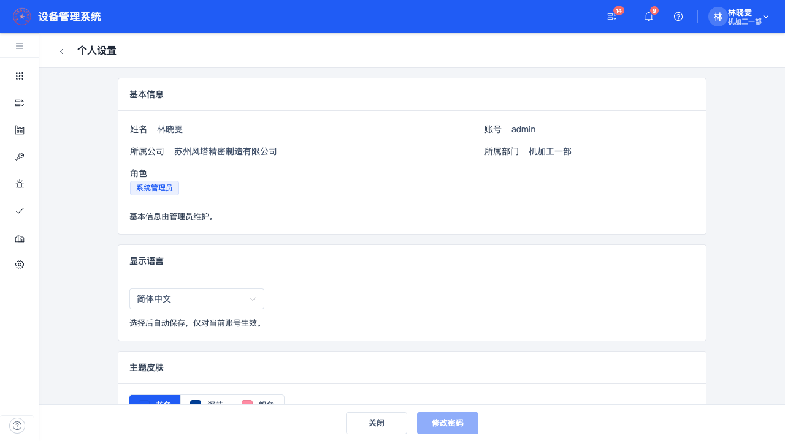
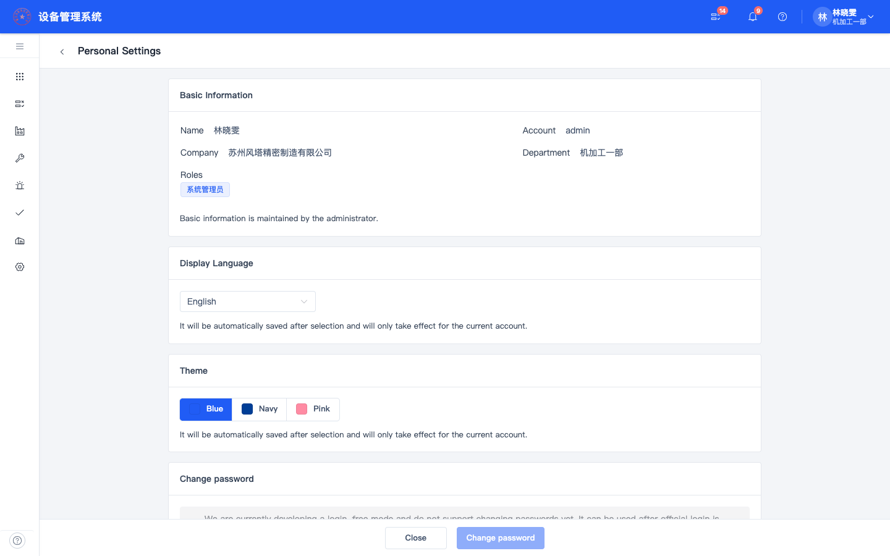
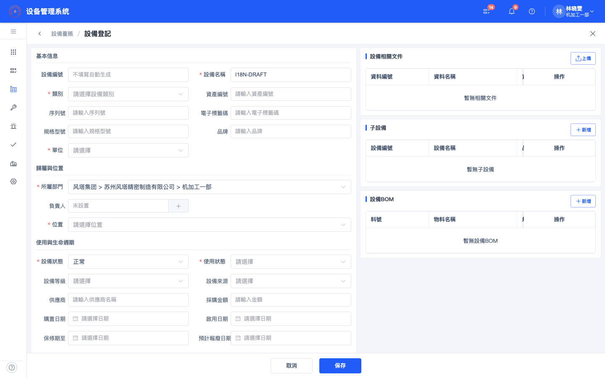
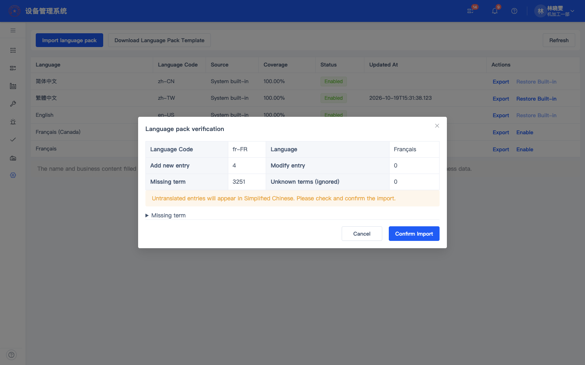

# 多语言实施与验证记录（2026-10-19）

本记录只对应本次工作区版本，不替代后续版本验收，也不将既有历史测试结果算入当前结果。

## 已实现

- 简体、繁体、英文共用稳定词条目录；3257个词条含业务界面、服务器提示、组件和日历文案。英文术语覆盖优先于机器初稿，缺失项回退简体。
- 个人设置和登录页语言选择，按账号单独保存；切换不刷新页面；语言与主题独立更新。清理上一账号语言缓存、忽略迟到响应。
- 系统管理 → 语言管理；单一 language.查看 权限。模板、JSON校验/预览/确认、覆盖、导出、启停、恢复内置、版本冲突与操作日志。
- 公共表格、筛选、上传、选择器、弹窗、底栏、动态字段外围校验及主要业务页面接入；系统枚举只翻译显示，ID、状态存值和权限动作不变。
- 后端统一消息快照、字段错误、异步导入上下文；新通知消息键与参数；设备导入模板、报告的系统文案，设备/维修/保养/巡检等导出表头及默认单据打印接入。
- V85/V86/V87：账号locale、语言元数据、覆盖词条、管理日志、通知消息元数据及词条模块。没有替换核心业务字段或重算库存。
- 按租户/语言/版本缓存、ETag及客户端聚焦/定时版本检查；组件占位参数交由Element Plus处理。

## 已验证

所有变更业务数据、账号偏好和语言包的验收请求限定在 **eam_i18n_test_20261019**；普通本地库只执行功能迁移及只读启动检查。

| 检查 | 当前结果 |
|---|---|
| 前端类型、词条/参数/消息语法、图标/表格/控件检查 | 通过 |
| 前端单元回归 | 22项通过 |
| 后端 clean package 重新生成的单元/契约/分层测试 | 126项通过，0失败、0跳过；清除了旧报告后计数 |
| 前端生产构建 | 通过；存在构建器的大包体提示 |
| 多语言接口验收 | 21个场景通过 |
| 正式认证隔离服务的权限/账号验收 | 6个场景通过 |
| 三语言模板及默认打印 | 通过；三种PDF均已渲染检查，示例为1页 |
| 设备、保养、巡检英文CSV系统表头 | 通过；客户业务名称保留原文 |
| 页面实际交互 | 语言选择、JSON导入校验与确认、设备草稿切换至繁体后仍保留；无页面运行错误 |
| 两种桌面尺寸 | 1280×720、1440×900抽查个人设置、设备列表、语言管理、保养任务、出库列表；无整页横向溢出 |
| 普通本地服务 | 5177前端、8080后端可用，健康UP，迁移至V87，默认zh-CN |

接口场景包括独立主题/语言保存、非法/空语言字段错误、后端字段错误、部分法语导入、缺失回退、未知键忽略、占位参数错误、原型键/HTML拒绝、未闭合参数和错误日历拒绝、内置保护、启停及保留原偏好、并发版本409、内置覆盖恢复。

权限场景覆盖匿名资源读取与管理401、普通账号所有管理入口403、仅菜单权限即可维护、部分包导出不夹带中文回退、两账号偏好隔离、新会话读回原账号偏好。

## 未验证

- 未以三种语言逐一重跑维修、保养、点巡检、库存的全部业务操作组合与所有历史数据情况。本次通过的测试不等于这些流程已全部完成业务验收。
- 真实多设备/跨浏览器登录采用新会话验证持久化，尚未使用多台物理设备验收。
- 所有角色、所有页面、所有弹窗的长英文排版尚未逐页人工验收；当前为所列页面抽查。
- 未进行生产环境验证、超大语言包压力测试、海量打印多页组合验收。
- 英文、繁体尚未完成母语人员逐句审校；词条完整率和语法检查不能证明翻译质量。

## 已知边界与遗留内容

- RTL未包含；阿拉伯语等不予启用。
- 设备/公司/部门/字典/自定义字段及客户填写内容保留原文；历史纯文本通知、旧首页自定义标题和管理员自定义打印文字不批量翻译。这些原文不能据此算作漏翻。
- 英文包含机器初稿及人工术语修订，繁体包含OpenCC转换；建议正式对外使用前完成术语审校。
- 当前静态硬编码检查覆盖Vue静态可见文字/属性与三语资源键一致性，不证明所有运行时分支零遗漏。
- 构建有大于500kB的分包提醒，未为此扩大本轮业务或打包结构改造。

- 已存校验批次的错误原因保留校验发生时的语言；切换语言后重新校验可生成对应语言说明，尚未对历史批次正文提供跨语言重绘。
- 追加调整：设备导入模板的部门、位置完整路径使用 ` > `；服务端同时注册旧 ` · ` 路径别名，类别规则保持不变。已下载普通本地模板核对部门及多级位置。

## 可复查证据

- [结构化结果和运行包指纹](../verification/i18n-20261019/summary.json)
- [接口场景](../verification/i18n-20261019/api.json)
- [权限与账号场景](../verification/i18n-20261019/permissions.json)
- [模板、导出与打印结果](../verification/i18n-20261019/outputs.json)
- [UI运行错误记录](../verification/i18n-20261019/ui.json)
- 复查脚本：scripts/qa/i18n-acceptance.py、i18n-permissions.py、i18n-ui.mjs、i18n-outputs.py。写入脚本固定隔离API端口，不能改为普通本地库或客户库运行。

## 页面截图

### 简体中文

### English

### 繁體中文

### 语言包导入

